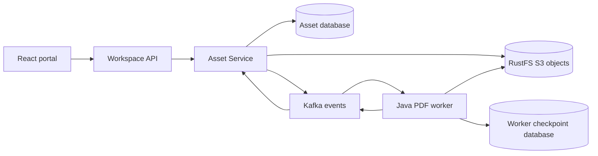

# Atlas Workspace Lab

Public, independent TypeScript/React and Java/Spring Boot demonstration of
spec-driven development, versioned contracts and a recoverable asynchronous
asset-processing flow. Synthetic documents and identities only.

LAB-101 is implemented for local review. Human PR review is still required;
this is not a production deployment or a demonstration of production availability.
Approval evidence: [LAB-101 approval](docs/implementation/LAB-101-APPROVAL.md).
Verification: [delivery evidence](docs/implementation/LAB-101-EVIDENCE.md).



The two databases have distinct owners and credentials on one PostgreSQL
instance. Asset Service owns metadata and authoritative status. The worker
owns its checkpoints and reads objects through a separate read-only identity.
RustFS replaces MinIO under the owner's explicit approval; applications use
the official AWS S3 SDK and the approved HTTP/event contracts are unchanged.

## Run locally

Requires JDK 21, Node.js 24, pnpm 10 (Corepack), Docker with Compose, and ports
5173, 8080, 8081, 5432, 9092 and 9000 available. Run from the repository root.

```sh
corepack enable
pnpm install --frozen-lockfile
pnpm local:prepare
pnpm local:up
pnpm test:integration
node scripts/local/apps.mjs
```

In a second terminal:

```sh
pnpm --filter @atlas/portal-ui dev --host 127.0.0.1
```

Open http://127.0.0.1:5173. Generate a short-lived **synthetic demo token** using
`node scripts/local/token.mjs` and paste it into the labelled token field.
Use `node scripts/local/token.mjs b` for the second synthetic tenant. Upload a
synthetic PDF of at most 5 MiB. Never paste production tokens or upload real data.
The UI keeps the token only in memory; token generation is an offline fixture,
not a production authentication system.

Preparation creates ignored `.env` credentials and `.local/` RSA keys with
restricted permissions. It refuses to overwrite an existing `.env`. Keep the
same credentials with their existing volumes. Ctrl+C stops the applications;
`docker compose stop` stops dependencies while preserving data.

## Verify

```sh
pnpm check:all
pnpm check:contracts
./gradlew test --no-daemon
pnpm test:integration
pnpm --filter @atlas/portal-ui build
pnpm test:frontend
pnpm exec playwright install chromium
pnpm test:e2e
node scripts/local/measure-builds.mjs
node scripts/local/install-trivy.mjs
node scripts/security.mjs
```

Run integration and E2E suites sequentially in this disposable environment:
integration fixtures reset their own databases. E2E starts and stops applications
and includes intentional worker/storage failures and container recreation.
Do not run it alongside a manually started application harness.

`test:integration` builds independently runnable JVM artifacts and enforces
at least 75% measured source line coverage in each Java module. Vitest enforces
75% lines, branches, functions and statements. GitHub Actions separately runs
scaffold checks, frontend, Java unit tests, contracts, integration/E2E and security.
A scaffold check alone provides no application verification.

See the [operations runbook](docs/implementation/LAB-101-RUNBOOK.md) for failure
handling, limitations, dependency provenance and rollback. Builds are coordinated
with Nx/pnpm and Gradle; no Python or AI/model runtime is deployed.
