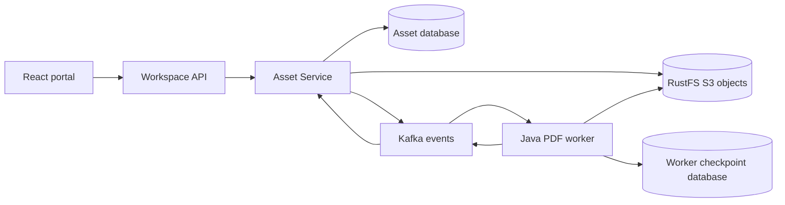

# Atlas Workspace Lab

Public, independent TypeScript/React and Java/Spring Boot demonstration of
spec-driven development, versioned contracts and a recoverable asynchronous
asset-processing flow. Synthetic documents and identities only.

LAB-101 is implemented for local review. Human PR review is still required;
this is not a production deployment or a demonstration of production availability.
Approval evidence: [LAB-101 approval](docs/implementation/LAB-101-APPROVAL.md).
Verification: [delivery evidence](docs/implementation/LAB-101-EVIDENCE.md).



The two databases have distinct owners and credentials on one PostgreSQL
instance. Asset Service owns metadata and authoritative status. The worker
owns its checkpoints and reads objects through a separate read-only identity.
RustFS replaces MinIO under the owner's explicit approval; applications use
the official AWS S3 SDK and the approved HTTP/event contracts are unchanged.

## Run locally

Requires JDK 21, Node.js 24, pnpm 10 (Corepack), Docker with Compose, and ports
5173, 8080, 8081, 5432, 9092 and 9000 available. Run from the repository root.

```sh
make doctor
make setup
make dev
```

Run `make token` (or `make token TENANT=b`) in another terminal.
`make dev` builds Java artifacts and starts dependencies, Java apps and Vite.
Ctrl+C stops application processes; `make stop` stops dependencies and preserves data.
Setup preserves complete existing credentials and rejects partial credential state.
Install host runtimes yourself; setup does not install Node, Java or Docker.

Open http://127.0.0.1:5173. Generate a short-lived **synthetic demo token** using
`make token` and paste it into the labelled token field.
Use `make token TENANT=b` for the second synthetic tenant. Upload a
synthetic PDF of at most 5 MiB. Never paste production tokens or upload real data.
The UI keeps the token only in memory; token generation is an offline fixture,
not a production authentication system.

Preparation creates ignored `.env` credentials and `.local/` RSA keys with
restricted permissions. It refuses to overwrite an existing `.env`. Keep the
same credentials with their existing volumes. Ctrl+C stops the applications;
`docker compose stop` stops dependencies while preserving data.

## Verify

```sh
make check
make test-tools
make build
make up
make test
make measure-builds
make install-trivy
make security
```

Run integration and E2E suites sequentially in this disposable environment:
integration fixtures reset their own databases. E2E starts and stops applications
and includes intentional worker/storage failures and container recreation.
Do not run it alongside a manually started application harness.

`test:integration` builds independently runnable JVM artifacts and enforces
at least 75% measured source line coverage in each Java module. Vitest enforces
75% lines, branches, functions and statements. GitHub Actions separately runs
scaffold checks, frontend, Java unit tests, contracts, integration/E2E and security.
A scaffold check alone provides no application verification.

See the [operations runbook](docs/implementation/LAB-101-RUNBOOK.md) for failure
handling, limitations, dependency provenance and rollback. Builds are coordinated
with Nx/pnpm and Gradle; no Python or AI/model runtime is deployed.

## Make command reference

Run `make` or `make help` for descriptions. All existing package scripts remain available.

| Commands | Underlying operation |
| --- | --- |
| doctor, setup, prepare | Prerequisite validation, locked installation and safe local preparation |
| dev, apps, ui | Full foreground demo, Java harness, Vite |
| up, stop, status | Existing local dependency startup, Compose stop and ps |
| token TENANT=a/b | Offline synthetic token fixture |
| build, build-ui | Gradle assemble plus UI build, UI build only |
| test, test-tools | Sequential complete suite, Node helper tests with coverage gates |
| test-java, test-frontend, test-integration, test-e2e | Corresponding pnpm test scripts |
| check | Scaffold, architecture and contract checks sequentially |
| check-scaffold, check-architecture, check-contracts | Corresponding pnpm check scripts |
| graph, affected-build, affected-test | Nx graph and affected targets through pnpm |
| measure-builds | Existing build measurement script |
| install-trivy, security | Checksum-verified scanner installation, repository/image scans |

Integration and E2E require running dependencies; E2E requires built Java artifacts.
Stop `make dev` before running tests. Security scans require `make install-trivy`
and built dependency images (`make up`). Make serializes its targets even with `-j`;
do not launch independent test commands concurrently.

## Run the complete stack in Kubernetes

LAB-103 adds a separate **local-only** kind deployment. Host builds use JDK 21,
Node 24 and pnpm 10; all runtime components run in pods, including the static UI,
workspace API, asset service, worker, PostgreSQL, Kafka and RustFS. Docker needs
at least 4 CPUs and 6 GiB RAM. `kubectl` must be within one minor of Kubernetes
1.35; exact kind/node/base-image pins are in `infra/k8s/versions.json`.

```sh
make setup             # existing host dependencies and Chromium
make k8s-tools         # explicit checksum-verified local kind installation
make k8s-doctor
make k8s-dev            # setup, immutable image build/load, up, loopback forwarding
```

In another terminal, `make k8s-token` generates the synthetic fixture token for
http://127.0.0.1:5173 (`TENANT=b` selects the second synthetic tenant). Do not run
the Compose UI or test harness on port 5173 at the same time.

`make k8s-setup`, `make k8s-build` and `make k8s-up` can also run separately.
`make k8s-forward` opens an existing deployment. `make k8s-status` and
`make k8s-logs` inspect it. `make k8s-stop` scales workloads to zero while retaining
PVCs and secrets. Ctrl+C stops forwarding and leaves pods/data in place.
`make k8s-test` verifies helpers and runs real cluster E2E/failure scenarios;
stop manual forwarding before running tests. `make k8s-security` scans rendered
manifests and every workload image after `make install-trivy`.

Credentials live separately under ignored `.local/k8s/` and are never silently
rotated. A dedicated kubeconfig and explicit `kind-atlas-lab` context protect
unrelated clusters. Do not delete or regenerate credentials against existing
PVCs. Kubernetes Secrets are not an encryption-at-rest guarantee. This is a
single-node synthetic-data demonstration, with no HA, backup or production claim.
See [Kubernetes operations](docs/implementation/LAB-103-RUNBOOK.md).
