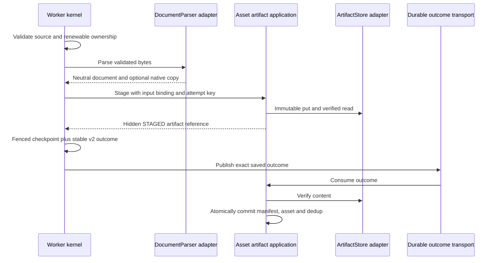

# LAB-108 — Portable processing and asset-owned artifacts

This is a synthetic local demonstration. LAB-108 revision 1 was approved at
`6bcb255`; see its OpenSpec approval record. Release review and dev integration
remain separate from implementation approval. Never run maintenance against an
unreviewed context, live data or another worktree's environment.

## Ownership and bindings

The worker owns its execution ledger, renewable fences and stable outcome outbox.
It reads source PDFs and calls an application-owned `DocumentParser` port only
**after** the PDF validation gate succeeds. Docling is an outbound adapter inside
an independently deployed Python parser. The core result contains Markdown,
source checksum, page count and opaque provenance. Native JSON is optional.

Asset-service owns derived lifecycle metadata and the separate `synthetic-derived`
bucket. `ArtifactStore` exposes immutable put-if-absent and read. Asset-service
verifies bytes before staging, before consuming completion and on public reads.
Normal store credentials have no deletion or listing capability. Source credentials
cannot access the derived bucket. The worker receives a distinct workload key
for the staging API, never the derived storage password. Parser pods receive
neither DB credentials nor storage credentials.



A consumer handler/database/content-verification failure stops that Kafka listener
without acknowledging the input. This retains the existing fail-closed policy:
repair the dependency, then explicitly restart the affected service to redeliver.
It is not automatic consumer recovery. Worker processing/publication retries are
separate bounded ledger operations; never edit offsets or publish a new event ID
as a recovery shortcut.

New normal execution stores no document bodies in the worker ledger. Legacy
`parsed_document` remains for compatibility and verified rollback; its presence
is not permission for new portable executions to write there.

The `ParsedArtifacts` application is tested with an in-memory store/catalog and
with the real JDBC/RustFS adapters. The processing kernel is tested with alternate
parser, source, execution and completion implementations. Provider replacement
still requires the replacement to satisfy the versioned wire contract and the
same security/quality bounds. Independent deployment alone proves neither.

## Dev commands

Use a task worktree and task branch; reviewed integration targets `dev`. All local
development commands use `ENV=dev`. An existing environment's credentials and
PVCs must be preserved. The following starts a fresh isolated demo cluster:

```sh
make setup
ATLAS_CLUSTER=atlas-lab-demo ENV=dev make helm-tools helm-setup helm-build helm-lint helm-up
ATLAS_CLUSTER=atlas-lab-demo ATLAS_UI_PORT=15173 ENV=dev make helm-forward
```

The dedicated kubeconfig is under `.local/k8s`; the context is checked against
kind before each mutation. `ATLAS_RUNTIME_ROOT=.local/<name>` can separate local
runtime metadata as well. Use the same variables for every command in that runtime.
Port overrides are loopback only. Existing defaults remain usable.

```sh
ATLAS_CLUSTER=atlas-lab-demo ENV=dev make parsed-copy ASSET_ID=<uuid>
ATLAS_CLUSTER=atlas-lab-demo ENV=dev make parsed-copy ASSET_ID=<uuid> FORMAT=json
ATLAS_CLUSTER=atlas-lab-demo ENV=dev make parsed-copy-legacy ASSET_ID=<uuid>
ATLAS_CLUSTER=atlas-lab-demo ENV=dev make helm-deploy SERVICE=processing-worker
```

`parsed-copy` uses `/api/v2/.../parsed`. JSON is the neutral
`{"schemaVersion":"1","markdown":"..."}` document. `parsed-copy-legacy` uses
v1 native JSON. v1 may return 404 when the selected parser has no native artifact;
it never fabricates a provider document. Reads require an authorized asset and
verified committed content. Corruption/unavailability returns an unavailable
response, with no silent fallback. A v1 404 can use the legacy reader during
transition; v2 never falls back to a different format.

The parser retains three replicas in the dev Helm profile. Output remains bounded
to 10 MiB combined UTF-8 Markdown/native bytes, input to 5 MiB/20 pages, with OCR
disabled and conversion/HTTP deadlines retained. Asset staging defaults to 100
pending manifests per tenant (`lab.artifacts.pending-limit`, allowed 1–1000).
Hitting the limit is retryable unavailability, not an implicit cleanup operation.

## Existing-environment rollout and migration

Fresh empty environments may start portable mode. For an environment with legacy
copies, deploy consumers and compatibility readers first using
`ATLAS_ARTIFACT_MODE=legacy` for the affected application releases. This sets
`LAB_ARTIFACT_ENABLED=false`; no v2 publisher starts. Preserve the old image
inventory and Helm revisions. Never dual-publish one outcome to v1 and v2.

The owner-scoped Java maintenance processes start no HTTP server, Kafka consumer,
scheduler or parser. They connect only to their own database. The operator opens
loopback forwards to the reviewed dev namespace; credentials are passed only to
the owner process that needs them, never through command arguments.

```sh
make artifacts-pause ENV=dev
make artifacts-snapshot ENV=dev
make artifacts-restore-check ENV=dev # restore DB/object snapshots into a separate Compose project
make artifacts-migrate ENV=dev
make artifacts-migrate ENV=dev       # prove repeatability
make artifacts-verify ENV=dev
make artifacts-reconcile ENV=dev    # dry-run only
make artifacts-rollback-copy ENV=dev # prove compatibility before enabling writes
```

Retain the same `ATLAS_CLUSTER` and `ATLAS_RUNTIME_ROOT` used to start the runtime.
Pause first scales the API to zero, waits for all processing/publications and
asset transitions to drain, then stops worker and asset writers. A failed drain
leaves a recorded maintenance window; inspect durable failures or use
`make artifacts-resume` to restore the recorded replica counts. Never edit ledger
state to make the drain check green.

Snapshots include owner-specific PostgreSQL dumps, a quiescent object-volume tar,
worker ledger and asset manifest snapshots, original copy export and per-tenant
counts/checksums. Files stay under ignored private `.local/.../maintenance` with
private file modes. A failed snapshot has no `snapshot-ready.json`; migration
refuses it. Exports are bounded to 1,000 rows/100 MiB, and individual documents to
10 MiB. Oversized environments require reviewed smaller batches; they are never
silently truncated. No startup backfill, reparse or destructive cleanup occurs.

Worker export includes original native JSON/Markdown bytes and source/event/
correlation/provenance binding. Asset import checks those against authoritative
asset metadata, verifies stored bytes and commits manifests idempotently. Failed
or conflicting rows stop verification and remain in the private export for
investigation. Per-tenant source/content/provenance checksums must agree.

Before cutover, run `make artifacts-restore-check ENV=dev`. It verifies snapshot
file hashes, restores both databases and the object tar into a separate Compose
project on allocated loopback ports, verifies owner exports there and stops its
containers while retaining volumes for inspection. Keep original
copies and snapshots until review completes. The snapshot command creates the
backup; it does not itself prove restoration.

After migration/rollback-copy verification, resume the dev environment and enable
portable mode consumer-first: asset-service, workspace-api, then processing-worker.
Use `ATLAS_ARTIFACT_MODE=portable make helm-deploy SERVICE=... ENV=dev`. The old v1
consumer remains. Do not enable new writes before this verification.

For rollback **after new portable writes**, pause/drain and snapshot again; run
`artifacts-rollback-copy` to restore all committed results into the worker-owned
legacy reader format and verify all tenant checksums. This includes new writes,
not just the historical migration batch. Native-less results deliberately block
this rollback; move affected v1 clients to v2 before selecting such a parser.
Only after successful verification restore the reviewed legacy routing/images and
resume. Never fabricate native JSON or discard new documents to make rollback pass.

`artifacts-reconcile` is a reference-only dry run: fresh paused worker/asset
snapshots, at most 1,000 candidates and a 60-second evaluation deadline. Committed,
referenced, missing or ambiguous state is retained. Eligible rows are only reported
as candidates. There is no deletion command or blind TTL policy in LAB-108.

## Verification and promotion

Commit the candidate before `make ci ENV=dev`: evidence must name an exact clean
Git revision. The runner fails fast, reserves separate Compose/cluster names and
runtime directories, uses separate loopback ports, and writes private evidence
under `.local/ci`. Individual checks remain available through Make while editing.
Port conflicts fail startup; the runner does not stop another environment.

Checks include contracts, architecture audit/tests, tooling coverage, Java unit/
integration coverage, frontend, offline parser quality, browser E2E, dev Kubernetes/
Helm E2E, and security scans. Local checks do not create hosted workflow runs.
Hosted workflows execute real build jobs only on a same-repository `dev` → `main`
promotion PR; invalid main PR sources fail the entry gate. No task push or dev PR
runs hosted CI. Required protections and human review must remain in force.

Do not infer production readiness, full architecture compliance, backup recovery,
replacement compatibility or successful promotion from a static audit or unit
coverage. Consult LAB-108 evidence for checks actually completed and remaining work.
